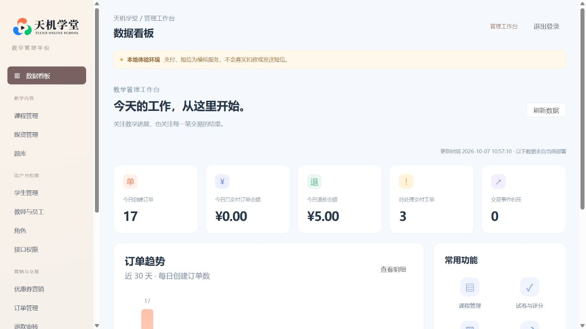

# 天机学堂 · 职业教育在线学习平台

[](https://github.com/W205614/Vocational-school/actions/workflows/reliability.yml)

基于 Java 21 / Spring Boot 4 与 Vue 3 的在线学习平台，提供学生门户和管理／教师工作台，覆盖 **购买课程 → 视频学习 → 考试 → 教师评分 → 退款与历史读取** 的业务流程。

本项目用于个人展示与本机功能、故障恢复验证。默认使用合成演示数据，支付和短信采用显式模拟服务，不会真实扣款或发送短信。

## 功能

- **课程与交易**：分类检索、课程详情、购物车、优惠方案、订单、模拟支付、取消及退款；管理端支持课程内容、封面、章节、优惠券和退款审核。
- **游客与选课**：未登录可搜索已上架课程并查看公开目录，购买和学习时登录并返回原课程；收费媒体、考试与个人数据仍需授权。
- **学习与互动**：周小节目标、最近进度续学、可搜索的时间点私人笔记、收藏、问答分页与教师答疑；回复产生站内通知。
- **积分与激励**：首次完成小节、签到和教师采纳回答计分；自然月赛季、历史榜、签到日历、个人成就、积分明细和可配置的赛季优惠券奖励。
- **考试与评分**：题库、不可变试卷版本、草稿自动保存、多设备版本冲突检测、提交与授权教师评分；学生可跨浏览器查看完成评分后的成绩、发布快照答案和教师反馈，并在错题本复习、标记掌握；复习不改原成绩。
- **管理与教师工作台**：业务看板、媒资上传、用户与角色权限、订单查询、操作审计；教师待评分列表支持分页及课程、学生筛选，授课学情和答疑按课程授权，授课与评分权限分别校验。
- **权益与历史**：课程权益随购买、退款和到期重新聚合；失效后禁止收费视频播放及学习、考试写入，保留本人已有的学习和考试历史。

## 界面预览

以下为 2026-10-07 保存的合成环境界面示例，实际布局以运行版本为准。

**学生门户**


**管理工作台**



## 技术栈

| 层次 | 技术与用途 |
| --- | --- |
| 后端 | Java 21、Spring Boot 4、Spring Cloud、MyBatis-Plus；业务接口、事务及持久任务 |
| 前端 | Vue 3、TypeScript、Vite、Element Plus、Pinia；学生与管理双端、共享客户端 |
| 数据与消息 | MySQL、Redis、RabbitMQ；业务事实、缓存、异步事件与补偿 |
| 搜索 | Elasticsearch 9.5.5、Java API Client / Rest5Client；从 MySQL 重建课程投影 |
| 验证 | JUnit、真实数据库与 HTTP 回归、Vitest、Playwright、Python 验收工具 |
| 部署 | Docker Compose、源码镜像构建、健康检查、停写备份与独立恢复 |

## 架构

默认运行组为 `tianji-compact`，共 **11 个容器**：4 个业务应用、1 个网关、2 个网页，以及 MySQL、Redis、RabbitMQ、Elasticsearch。合并的是部署单位，原业务模块及 12 个数据库继续保留。

```text
学生门户 / 管理与教师工作台
             │
       Gateway /api/v2
             │
    ┌────────┼────────┬─────────┐
 identity  commerce education support
    └────────┴────────┴─────────┘
             │
 MySQL / Redis / RabbitMQ / Elasticsearch
```

| 应用 | 包含模块 | 默认本机端口 |
| --- | --- | --- |
| identity | auth、user | 24001 |
| commerce | trade、pay、promotion | 24002 |
| education | course、learning、exam、remark | 24003 |
| support | media、search、message、data | 24004 |
| gateway | 入口鉴权、路由 | 24310 |

各业务模块拥有独立 Bean 容器、Mapper、连接池与事务管理器。模块间使用标准 Feign HTTP，同宿主指向回环地址，跨宿主指向服务地址；内部路径为 `/_modules/{alias}/...`，要求服务凭证。调用保留身份、请求编号和深度限制，各模块独立执行事务及补偿。Nacos 集成与原独立启动入口保留，本机关闭远程 Nacos 与 XXL-Job，持久后台任务由应用执行。

## 项目结构

```text
frontend/                    学生端、管理端、共享客户端与浏览器测试
tj-compact/                  四个业务启动模块与模块隔离
tj-common/ tj-api/ tj-auth/   公共基础、调用契约、会话与安全 SDK
tj-user/ tj-course/ tj-exam/ tj-learning/ tj-remark/  身份与教学业务
tj-trade/ tj-pay/ tj-promotion/                    交易业务
tj-media/ tj-search/ tj-message/ tj-data/          支撑业务
tj-gateway/                  网关与显式接口权限清单
deploy/compact/              启动、验收、备份恢复及性能工具
deploy/acceptance/           结构基线、迁移、合成夹具与隔离回归
deploy/final/                旧部署及可复用备份组件
docs/                       运行手册与历史验收证据
```

## 快速启动

### 首次从源码启动

准备 JDK 21、Maven、Node.js 22/npm、Python 3.12+、Docker Compose 及可用镜像源，确认命令已加入 PATH。在仓库根目录执行：

```powershell
python -m pip install -r deploy/compact/requirements.txt
npm --prefix frontend ci
python deploy/compact/setup.py prepare
python deploy/compact/setup.py init
python deploy/compact/setup.py build
python deploy/compact/setup.py up
python deploy/compact/prepare_search.py
python deploy/compact/rebuild_search.py
```

初始化使用仓库内的结构与合成数据，不依赖私有历史 JAR 或旧库；发现未经初始化器管理的已有业务库时拒绝覆盖。构建记录 Git 提交和产物哈希，拒绝未提交的生产源码改动，修改代码后应先提交再构建。`-Pcompact` 构建合并应用，默认 Maven 配置仍支持独立模块。

| 入口 | 本机地址 |
| --- | --- |
| 学生门户 | <http://127.0.0.1:24500/> |
| 管理与教师工作台 | <http://127.0.0.1:24501/> |
| API 网关 | <http://127.0.0.1:24310/api/v2/> |

所有发布端口绑定回环地址。随机生成的学生、管理员、教师账号保存在 `deploy/compact/.local/accounts.json`；该文件、私有配置、签名密钥及备份不提交到 GitHub。

### 已有部署

```powershell
# 查看状态
docker compose -p tianji-compact -f deploy/compact/compose.yaml --env-file deploy/compact/.env ps
# 暂停
docker compose -p tianji-compact -f deploy/compact/compose.yaml --env-file deploy/compact/.env stop
# 恢复启动
python deploy/compact/setup.py up
```

代码更新需重新构建镜像；若本地 Compose 已固定镜像 ID，还需核对其引用与新构建清单一致再重建容器。运行数据在命名卷，上传字节在 `deploy/compact/.local/objects`。保留数据与配置，禁止用 `down -v` 或全局 Docker prune 清理部署。操作细节见 [部署手册](deploy/compact/README.md)。

## 使用流程

1. 管理员维护课程、章节、媒资、题库和试卷，并配置教师权限。
2. 学生浏览课程、领取优惠券，加入购物车后下单并完成模拟支付。
3. 获得权益后播放视频、保存学习进度，记录私人笔记或参与讨论。
4. 学生保存答题草稿并提交考试，授权教师在工作台评分。
5. 学生查看成绩与反馈；退款审核完成后核对权益变化及只读历史。

详细学习、赛季、复习和教师操作规则见 [学习体验说明](docs/learning-experience.md)。

## 核心机制与安全

- **交易与异步可靠性**：支付、退款和关闭订单删除共用订单锁；事务 Outbox、消费去重、失败重放与补偿处理重复、迟到事件。本人只能删除已关闭订单，管理查询区分课程名称快照与学员姓名。
- **权益与考试一致性**：权益从有效订单明细重新聚合，永久权益优先，退款可缩短期限；考试保留题目快照和完整答案集合，提交后只读，重复提交或事件不重复累加进度。
- **会话与权限**：刷新令牌轮换、独立会话撤销；改密、禁用和角色变化更新安全版本，网关缓存最长 5 秒。登录按账号及实际来源 IP 限流，网关默认拒绝未声明接口并清除伪造身份头，业务侧核对数据归属。
- **资源与数据边界**：运行账号只拥有所属数据库的 DML 权限，迁移单独执行；有界执行器、内部请求及上传并发限制、图片大小与像素限制。库存和限领以数据库为准，缓存与搜索投影可重建。
- **可观测性**：容器健康检查、受凭证保护的 Actuator/Prometheus 指标、失败及补偿任务查询、持久操作审计。当前运行组没有单独部署 Prometheus/Grafana。

## 验证摘要

最近一次本机完整功能验收为 **2026-10-11，运行源码 `c3d6971`**。后续文档提交不改变已构建镜像的源码归属。

| 范围 | 已验证结果 |
| --- | --- |
| 后端与工具 | 后端 133 项通过（含真实套接字 9 项）；部署工具 32 项通过 |
| 前端与浏览器 | 类型检查、双端构建及单元测试 3 项通过；浏览器 32 项通过、0 失败，20 个角色不适用执行槽跳过 |
| 安全与运行 | 安全 26 项、3 类审计通过；最终 11 个容器健康 |
| 数据与恢复 | Redis、独立备份恢复、搜索 9→7→9 回退及既有业务记录／媒资保留验证通过 |

这些结果针对选定回归、本机合成数据与模拟服务。完整断言、失败诊断、数据校验、历史修复及容器清理记录见 [交付报告](deploy/compact/reports/README.md)。

常用检查入口：

```powershell
python deploy/compact/check_policy.py
python deploy/compact/run_backend_tests.py
npm --prefix frontend run typecheck
npm --prefix frontend run test:unit
npm --prefix frontend run build
# 首次浏览器检查需安装 Chromium
Push-Location frontend
npx playwright install chromium
Pop-Location
python deploy/compact/run_browser.py
```

后端使用 `acceptance_*` 专用库；浏览器会创建课程、订单等合成验收数据。完整回归与核心回归清单由本地和 CI 共用，独立入口支持 `--suite regression/core`。环境准备、安全与审计检查顺序见 [部署手册](deploy/compact/README.md#回归)。CI 包括 `backend`、`frontend`、`compact-browser` 三个作业，状态以 [对应提交的 Actions 记录](https://github.com/W205614/Vocational-school/actions) 为准。

## 备份与恢复

完整备份停写后保存 SQL／触发器、私有配置和签名密钥、媒资字节、Redis 数据与到期时间、RabbitMQ 数据目录及内容校验和。校验后保存为独立恢复点，结束时恢复原服务并等待健康。

```powershell
python deploy/compact/backup.py
python deploy/final/final_backup.py --verify <完整备份目录>
python deploy/compact/rehearse_recovery.py <完整备份目录> --pause-source
```

恢复使用新的空目录、独立项目、卷与端口，先核对表内容、对象哈希及原业务历史，再运行新增业务验证。备份记录镜像标识但不包含镜像字节，换机需另行取得对应镜像。搜索回退从切换时的 MySQL 重建投影，禁止用旧 SQL 覆盖新增业务数据。详见 [恢复操作](deploy/compact/README.md#备份与独立恢复) 和 [可靠性手册](docs/reliability-runbook.md)。

## 已知边界

- 原离线历史业务数据未迁入当前合成演示环境；真实支付／短信、正式历史切换及多节点高可用未验收。
- 优惠方案最多计算选定的 6 张用户券；持券更多时先选券，也可以不用券继续购买。积分基于系统记录的完成状态，不宣称具备完整防作弊能力；赛季优惠券默认关闭。
- 性能工具与旧部署能力保留，正式性能采样和容量指标未完成验证，不能用容器数量推导性能结论；具体协议与状态见交付报告。

## 文档

- [部署与验收手册](deploy/compact/README.md)
- [交付报告、修复与清理记录](deploy/compact/reports/README.md)
- [可靠性运行手册](docs/reliability-runbook.md)
- [旧部署记录](deploy/final/README.md)
- [历史交付与压测状态](docs/productionization-status.md)
