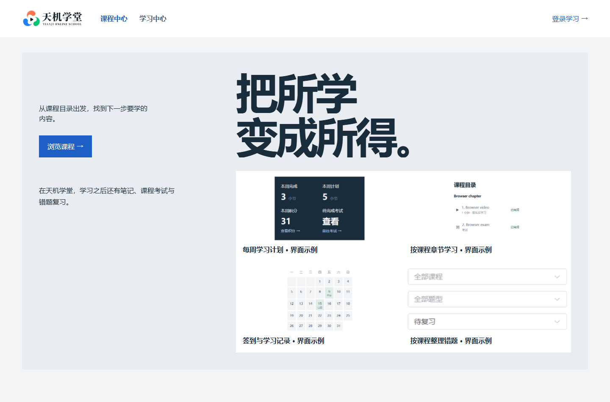
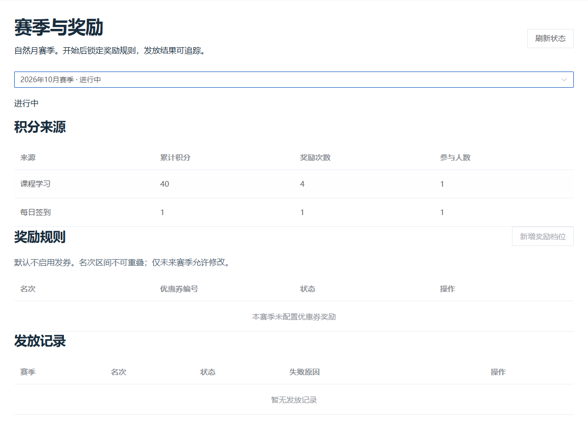
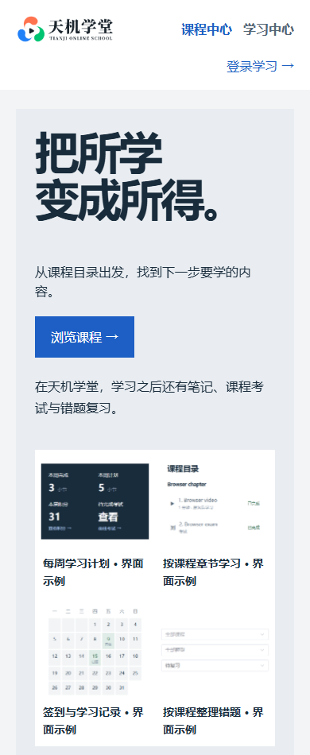
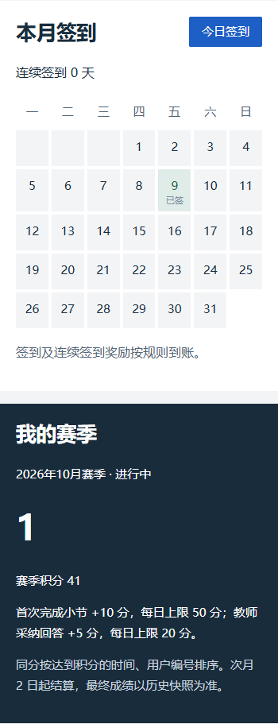
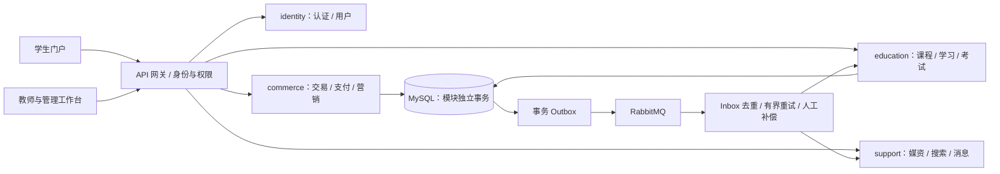

# 天机学堂 · 职业教育在线学习平台

天机学堂是基于 Java 21 / Spring Boot 4 和 Vue 3 的在线学习平台，提供学生门户、教师与管理工作台，串联 **选课 → 购买 → 学习 → 考试 → 错题复习 → 积分激励**。

适合本地体验在线教育业务、学习 Java 多模块架构与前后端协作。默认部署使用合成演示数据，支付与短信为本地模拟，不会真实扣款或发送短信。

[快速部署](#快速部署) · [首次使用](#首次使用) · [界面预览](#界面预览) · [项目结构](docs/project-structure.md) · [更多文档](#更多文档)

## 功能与解决的问题

| 场景 | 提供的功能 | 解决的问题 |
| --- | --- | --- |
| 选课与购买 | 游客课程检索、课程介绍与目录、购物车、优惠券、模拟支付、退款 | 将选课、交易和课程学习权益串联起来 |
| 日常学习 | 周学习计划、进度续学、时间点私人笔记、课程问答与教师答疑 | 帮助学生安排进度、记录疑问并继续学习 |
| 考试与复习 | 答题草稿、提交考试、教师评分、成绩与反馈、错题本 | 将考试结果与后续复习衔接起来 |
| 学习激励 | 签到日历、学习积分、月度榜单、成就、可配置优惠券奖励 | 集中展示学习记录，为持续学习提供反馈 |
| 教学与运营 | 课程与章节管理、媒资上传、题库试卷、授课学情、角色权限、操作审计 | 为教师和管理员提供统一工作入口 |

退款或课程权益到期后，学生仍可查看本人的学习、考试历史；收费视频和新的学习、考试操作由后端校验权限。赛季优惠券奖励默认关闭，可由管理员配置。

## 界面预览

以下为 2026-10-16 本地演示部署截图，使用合成数据；门户中的功能片段标注为“界面示例”。

**学生门户 · 桌面**



**管理工作台 · 赛季与奖励**



<details>
<summary>查看移动端：课程门户与积分签到</summary>

<p>
  
  
</p>

</details>

## 快速部署

### 1. 准备环境并获取代码

默认方式为**本机源码构建 + Docker Compose 部署**。准备以下工具并加入 `PATH`：

- Git、JDK 21（含 `javac` 和 `keytool`）、Maven。
- Node.js 22 / npm、Python 3.12+。
- Docker Engine 与 Compose v2；Windows 可使用 Docker Desktop 的 Linux 容器模式。
- 能下载 Maven/npm 依赖及 Docker 镜像的网络。Docker 内存预算建议预留 12 GB（按当前容器内存上限估算，并非实测最低配置）。

以下命令以 **Windows PowerShell** 为例，后续均在仓库根目录执行：

```powershell
git clone --branch dev https://github.com/W205614/Vocational-school.git
cd Vocational-school
python -m pip install -r deploy/compact/requirements.txt
npm --prefix frontend ci
```

### 2. 初始化、构建并启动

**以下步骤用于全新部署。已有部署直接看[日常启停与常见问题](#日常启停与常见问题)，升级请按[部署手册](deploy/compact/README.md)操作。**

按顺序逐条执行；某一步报错时先处理错误，再继续：

```powershell
# 生成本地配置、签名密钥与中间件密码
python deploy/compact/setup.py prepare

# 启动基础服务，初始化数据库、演示数据与登录账号
python deploy/compact/setup.py init

# 从源码构建后端、前端及应用镜像；首次执行需下载依赖
python deploy/compact/setup.py build

# 启动应用与网页，等待健康检查
python deploy/compact/setup.py up

# 创建课程搜索索引，并同步课程数据
python deploy/compact/prepare_search.py
python deploy/compact/rebuild_search.py
```

不需要私有历史 JAR、旧数据库备份或真实支付密钥。构建脚本要求生产源码已提交；首次体验直接使用克隆后的代码即可。默认 Compose 项目名为 `tianji-compact`，包含 11 个业务／基础设施容器和 3 个本机监控容器。

### 3. 打开页面并获取账号

| 入口 | 地址 | 登录角色 |
| --- | --- | --- |
| 学生门户 | [http://127.0.0.1:24500/](http://127.0.0.1:24500/) | 游客可浏览；学生登录后购买、学习 |
| 教师与管理工作台 | [http://127.0.0.1:24501/](http://127.0.0.1:24501/) | 教师、管理员 |
| API 网关 | [http://127.0.0.1:24310/api/v2/](http://127.0.0.1:24310/api/v2/) | 接口入口，非网页首页 |
| 监控面板 | [http://127.0.0.1:24592/](http://127.0.0.1:24592/) | Grafana 用户 `tianji`，密码在本机 `deploy/compact/.env` 的 `ACCEPTANCE_GRAFANA_PASSWORD` |
| 本机告警 | [http://127.0.0.1:24591/](http://127.0.0.1:24591/) | Alertmanager，无外部通知 |

初始化后，在本机查看登录信息：

```powershell
Get-Content deploy/compact/.local/accounts.json
```

分别使用 `student`、`teacher`、`admin` 下的 `username` 和 `password` 登录对应端。密码随机生成，账号文件仅保存在本地，不要提交或公开。

## 首次使用

1. **游客选课**：打开学生门户，搜索课程并查看详情、章节目录，无需先登录。
2. **学生体验**：使用学生账号登录，将课程加入购物车并完成模拟支付；进入「我的学习」设置周目标、继续学习、记录笔记，再查看考试、错题本和积分签到。
3. **教师体验**：在管理工作台使用教师账号登录，进入「授课学情与答疑」或「考试」查看授权课程、答疑和待评分答卷。没有提交的答卷时，待评分列表为空。
4. **管理员体验**：使用管理员账号登录管理工作台，维护课程、章节、媒资、题库和试卷；在「赛季与奖励」查看积分来源并配置未来赛季奖励。

优惠券抵扣全部金额时，订单直接按「零元成交」完成，不进入付款页；优惠券确认与学习权益仍由持久事件处理。零元退课沿用原审批流程，不发起渠道退款。管理员可在「可靠性与补偿」核对渠道异常并记录处理依据。

教师授课权限与评分权限分别配置。详细页面说明、计分和奖励规则见[学习与教学使用说明](docs/learning-experience.md)。

## 日常启停与常见问题

```powershell
# 查看容器状态
docker compose -p tianji-compact --project-directory deploy/compact -f deploy/compact/.local/compose.runtime.yaml --env-file deploy/compact/.env ps

# 暂停（保留数据）
docker compose -p tianji-compact --project-directory deploy/compact -f deploy/compact/.local/compose.runtime.yaml --env-file deploy/compact/.env stop

# 恢复启动
python deploy/compact/setup.py up
```

| 遇到的问题 | 处理方式 |
| --- | --- |
| 命令找不到或构建失败 | 确认工具已加入 `PATH`、Docker 已启动、依赖与镜像下载可用；脚本诊断日志位于 `deploy/compact/.local/`，例如 `maven.log`、`frontend.log`、`infra.log`、`up-None.log` |
| 页面打不开或启动失败 | 用上面的 `ps` 查看状态；检查本机端口是否被占用，端口映射见 `deploy/compact/compose.yaml`；用同一 Compose 命令将 `ps` 换成 `logs --tail 100` 查看日志 |
| 门户搜索不到课程 | 确认启动成功，并已执行两个搜索初始化与同步命令 |
| 不知道登录账号 | 查看 `deploy/compact/.local/accounts.json`，学生与教师／管理员使用不同网页入口 |
| 已有环境需要升级 | 先备份，再按[部署手册](deploy/compact/README.md)完成迁移、配置补全和重新构建；不要重复执行首次准备步骤 |

数据库等数据保存在 Docker 命名卷，上传文件在 `deploy/compact/.local/objects`。保留 `.env`、`.local` 和数据卷；**不要用 `docker compose down -v` 清理有数据的部署**。所有默认发布端口仅绑定本机回环地址，其他设备不能直接访问。

### 本机自动备份

Windows 下可注册每日北京时间 **03:30** 的完整备份任务：

```powershell
powershell -NoProfile -File deploy/compact/register_backup_task.ps1
```

备份只保存在本项目 `deploy/compact/.local/backup/`。新自动备份校验成功后，仅保留最近两份本脚本创建的自动备份；历史备份、手动备份和升级前回退备份不会自动删除。完整备份需要短暂停写，完成后恢复原服务状态。

**Docker Desktop 未运行时跳过，不自动启动它。** Docker 可用但业务容器已停止时，只临时启动备份必需的 MySQL、Redis、RabbitMQ，备份后恢复停止。任务每 15 分钟在后台无窗口检查是否欠缺备份，成功后不重复备份；需要 Python 目录含 `pythonw.exe`、主机及当前用户会话可用，不保存账户密码。03:30 是计划时间，条件不满足时会延后补执行。

跳过状态覆盖同一小文件，不持续追加日志；错误日志总量最多 3 MB。真正备份失败后暂停自动重试，处理原因后运行 `python deploy/compact/maintenance.py retry` 恢复。详细操作、告警及回退约束见[稳定性与运维说明](docs/stability-operations.md)。

## 技术与代码导航

后端使用 Java 21、Spring Boot 4、Spring Cloud、MyBatis-Plus；前端使用 Vue 3、TypeScript、Vite、Element Plus、Pinia。数据与消息使用 MySQL、Redis、RabbitMQ，课程搜索使用 Elasticsearch。

默认部署将原业务模块组合为 `identity`、`commerce`、`education`、`support` 四个应用，经网关为双端提供接口；业务模块仍保留各自的数据库与事务边界。



| 设计选择 | 原因与边界 | 可演示的证据 |
| --- | --- | --- |
| 四个组合应用，保留模块事务边界 | 降低本机进程成本；跨模块调用仍可能失败，不依赖一个全局事务 | 部署配置、模块启动入口与独立连接池 |
| 事务 Outbox、消费者去重、持久补偿 | 交易事实与待发事件同事务保存；消息允许重复，业务避免重复生效 | 失败分页、重放前后状态、支付退款与权益链路 |
| 服务端授权与不可变考试快照 | 学习权益、答卷归属和评分授权由后端判断；发布后题目变化不改历史答卷 | 未授权请求拒绝、教师评分与学生历史记录 |
| 请求上下文隔离与独立进度队列 | 慢响应不能覆盖新课程，页面交互不能阻断进度尾写 | 延迟响应测试、保存失败重试、切节续学 |
| 私有运行配置、不可变镜像绑定、完整备份 | 公共模板可复现，升级保留本机卷与 RabbitMQ 身份 | 源码 SHA、镜像 ID、配置等价检查及隔离恢复 |

面试演示可按三条路径展开：学生购课到教师评分的业务闭环；模拟接口失败后的局部重试和进度补写；管理员查询旧失败、定位模块并重放。项目既有业务与本次改造分别以 Git 记录和[批次验收报告](deploy/compact/reports/README.md)核对；不将仓库全部功能表述为个人原创贡献。

| 目录 | 内容 |
| --- | --- |
| `frontend/` | 学生端、管理端及共享客户端 |
| `tj-compact/` | 四个组合应用的启动入口 |
| `tj-user/`、`tj-course/`、`tj-learning/`、`tj-exam/` 等 | 用户、课程、学习、考试等业务模块 |
| `tj-common/`、`tj-api/`、`tj-auth/`、`tj-gateway/` | 公共组件、调用契约、认证与网关 |
| `deploy/compact/` | 当前默认部署、备份恢复与运维工具 |
| `docs/` | 使用说明、运行手册与历史交付记录 |

当前定位是个人演示与本机验证；真实支付／短信、正式容量及多节点高可用不属于已完成验收范围。

## 更多文档

- [目录职责、源码阅读顺序与本地文件边界](docs/project-structure.md)
- [文档导航](docs/README.md) · [部署与运维工具索引](deploy/compact/TOOLS.md)
- [学习、考试、赛季与教学使用说明](docs/learning-experience.md)
- [部署、升级与备份恢复手册](deploy/compact/README.md)
- [可靠性运行手册](docs/reliability-runbook.md)
- [历史验收、修复与交付证据](deploy/compact/reports/README.md)
