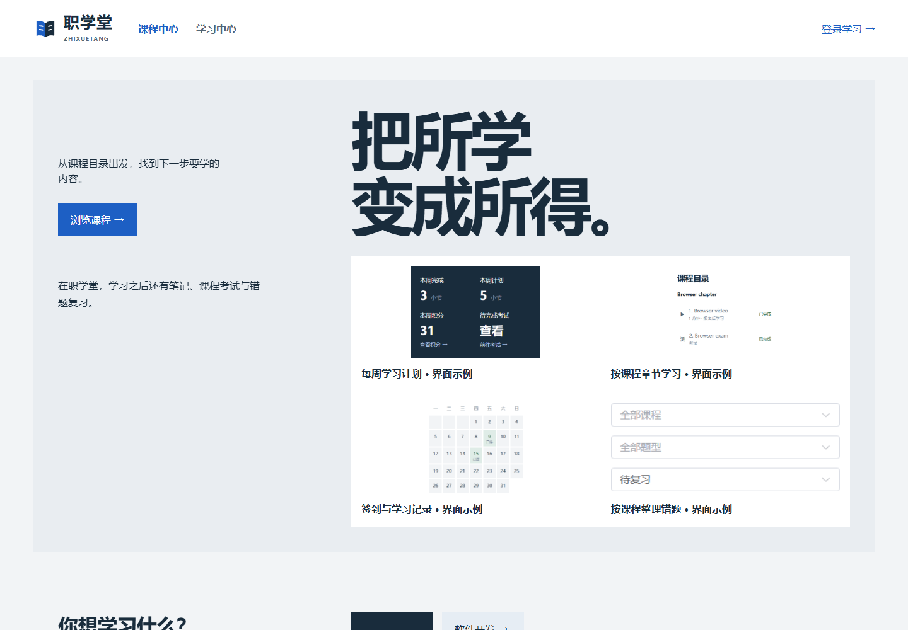
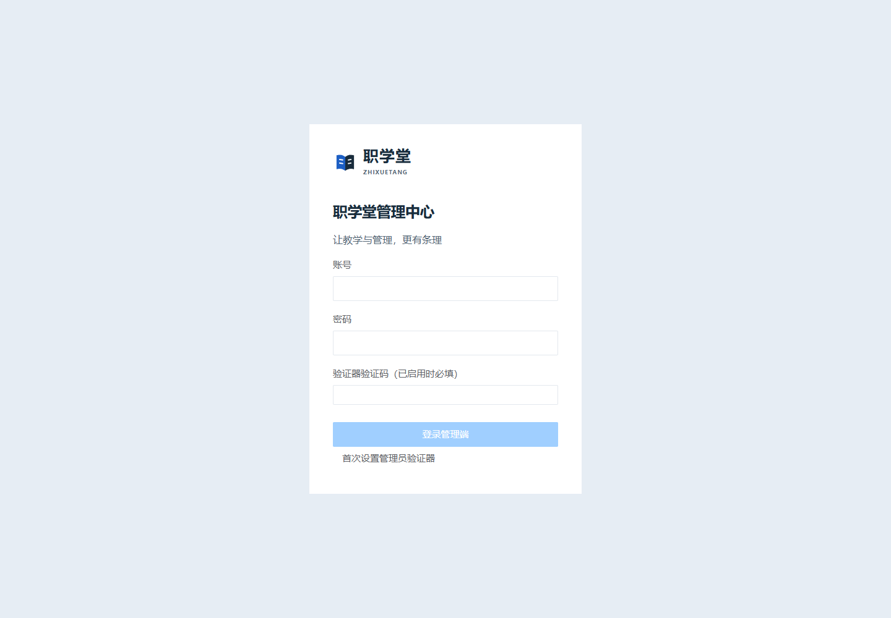
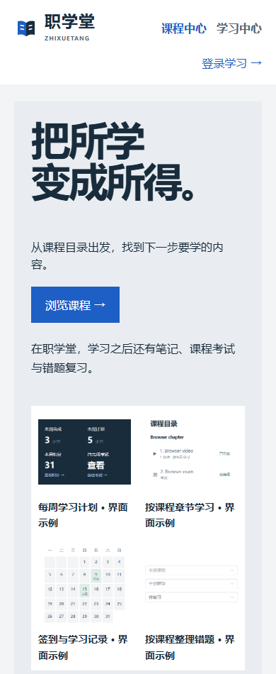
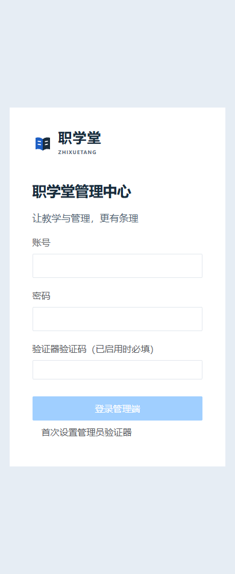

# 职学堂 · 职业教育在线学习平台

职学堂是基于 Java 21 / Spring Boot 4 和 Vue 3 的在线学习平台，提供学生门户、教师与管理工作台，串联 **选课 → 购买 → 学习 → 考试 → 错题复习 → 积分激励**。

当前品牌为 **职学堂 / Zhixuetang**，业务模块使用 `zxt-` 前缀和 `com.zhixuetang` 包名。历史交付记录保留当时的名称、素材来源、截图及验证范围。

适合本地体验在线教育业务、学习 Java 多模块架构与前后端协作。默认部署使用合成演示数据，支付与短信为本地模拟。

生产接入提供支付宝、阿里云短信、腾讯 COS 适配，以及安全试看、跨域隐私任务、首次配置和验收工具。真实供应商、云环境、容量与容灾仍待验收；软件交付状态、本地验证范围及接入顺序见[生产就绪说明](docs/production-readiness.md)。

项目按需维护，日常改动合入 `dev`。参与开发见[贡献指南](CONTRIBUTING.md)，安全问题报告见[安全政策](SECURITY.md)。

源码预览版本 `v0.1.0-preview.2` 的改动、验证和使用边界见[版本说明](docs/releases/v0.1.0-preview.2.md)。该版本采用源码构建方式，不附带预构建应用或镜像；`pom.xml` 的 `1.0.0` 是独立的 Maven 构建版本。

[首次部署](#全新环境准备) · [已有环境启动](#已有环境启动) · [源码导航](#源码导航)

## 快速部署

### 已有环境启动

已完成初始化和构建的环境，在仓库根目录运行：

```powershell
python deploy/compact/setup.py up
```

升级或启动失败时查阅[默认部署手册](deploy/compact/README.md)。保留本机配置、媒资和数据卷。首次部署按以下步骤执行。

### 全新环境准备

默认方式为**本机源码构建 + Docker Compose 部署**。准备以下工具并加入 `PATH`：

- Git、JDK 21（含 `javac` 和 `keytool`）、Maven。
- Node.js 22 / npm、Python 3.12+。
- Docker Engine 与 Compose v2；Windows 可使用 Docker Desktop 的 Linux 容器模式。
- 能下载 Maven/npm 依赖及 Docker 镜像的网络。Docker 内存预算建议预留 12 GB（按当前容器内存上限估算，并非实测最低配置）。

以下命令以 **Windows PowerShell** 为例，后续均在仓库根目录执行：

```powershell
git clone --branch dev https://github.com/W205614/Vocational-school.git
cd Vocational-school
python -m pip install -r deploy/compact/requirements.txt
npm --prefix frontend ci
```

### 初始化、构建并启动

按顺序逐条执行；某一步报错时先处理错误，再继续：

```powershell
# 生成本地配置、签名密钥与中间件密码
python deploy/compact/setup.py prepare

# 启动基础服务，初始化数据库、演示数据与登录账号
python deploy/compact/setup.py init

# 从源码构建后端、前端及应用镜像；首次执行需下载依赖
python deploy/compact/setup.py build

# 启动应用与网页，等待健康检查
python deploy/compact/setup.py up

# 创建课程搜索索引，并同步课程数据
python deploy/compact/prepare_search.py
python deploy/compact/rebuild_search.py
```

不需要私有历史 JAR、旧数据库备份或真实支付密钥。构建脚本要求生产源码已提交；首次体验直接使用克隆后的代码即可。默认 Compose 项目名为 `zhixuetang-compact`，包含 11 个业务／基础设施容器和 3 个本机监控容器。

## 首次登录与体验

| 入口             | 地址                                                             | 登录角色                                                                                 |
| ---------------- | ---------------------------------------------------------------- | ---------------------------------------------------------------------------------------- |
| 学生门户         | [http://127.0.0.1:24500/](http://127.0.0.1:24500/)               | 游客可浏览；学生登录后购买、学习                                                         |
| 教师与管理工作台 | [http://127.0.0.1:24501/](http://127.0.0.1:24501/)               | 教师、管理员                                                                             |
| API 网关         | [http://127.0.0.1:24310/api/v2/](http://127.0.0.1:24310/api/v2/) | 接口入口，非网页首页                                                                     |
| 监控面板         | [http://127.0.0.1:24592/](http://127.0.0.1:24592/)               | Grafana 用户 `zhixuetang`，密码在本机 `deploy/compact/.env` 的 `ACCEPTANCE_GRAFANA_PASSWORD` |
| 本机告警         | [http://127.0.0.1:24591/](http://127.0.0.1:24591/)               | Alertmanager，无外部通知                                                                 |

初始化后，在本机查看登录信息：

```powershell
Get-Content deploy/compact/.local/accounts.json
```

分别使用 `student`、`teacher`、`admin` 下的 `username` 和 `password` 登录对应端。密码随机生成，账号文件仅保存在本地，不要提交或公开。

1. **游客选课**：打开学生门户，搜索课程并查看详情、章节目录，无需先登录。
2. **学生体验**：使用学生账号登录，将课程加入购物车并完成模拟支付；进入「我的学习」设置周目标、继续学习、记录笔记，再查看考试、错题本和积分签到。
3. **教师体验**：在管理工作台使用教师账号登录，进入「授课学情与答疑」或「考试」查看授权课程、答疑和待评分答卷。没有提交的答卷时，待评分列表为空。
4. **管理员体验**：使用管理员账号登录管理工作台，维护课程、章节、媒资、题库和试卷；在「赛季与奖励」查看积分来源并配置未来赛季奖励。

启动成功后，可以在学生门户搜索到演示课程并打开详情，在管理工作台用对应角色登录。页面打不开或搜索为空时，见[日常启停与排障](deploy/compact/README.md#日常启停与常见问题)。

## 源码导航

默认部署由网关和四个组合应用对外提供服务。在业务模块中修改功能，在组合应用中查看这些模块如何一起启动。

| 想做什么                     | 从哪里开始                                                                                                            |
| ---------------------------- | --------------------------------------------------------------------------------------------------------------------- |
| 改学生页面、教师或管理员页面 | [学生端](frontend/apps/student/)、[管理端](frontend/apps/admin/)；共用请求和组件在[共享包](frontend/packages/shared/) |
| 改学习进度、课程或订单规则   | [学习](zxt-learning/)、[课程](zxt-course/)、[交易](zxt-trade/)                                                           |
| 查请求入口或跨模块调用契约   | [网关](zxt-gateway/)、[调用契约](zxt-api/)                                                                              |
| 查业务模块如何组合运行       | [组合应用](zxt-compact/)；学习模块由 [education](zxt-compact/education/) 装配                                           |
| 部署或排障                   | [本机部署手册](deploy/compact/README.md)、[运维工具索引](deploy/compact/TOOLS.md)                                     |

首次读代码可跟着[视频进度保存路径](docs/project-structure.md#视频进度如何保存)，从学生页面走到数据库和测试。

## 深入文档

- [文档导航](docs/README.md) · [目录职责与阅读顺序](docs/project-structure.md)
- [贡献指南](CONTRIBUTING.md) · [安全政策与报告渠道](SECURITY.md)
- [生产就绪状态与接入步骤](docs/production-readiness.md) · [供应商配置与验证命令](docs/production-integrations.md)
- [学习与教学使用说明](docs/learning-experience.md) · [账户安全](docs/account-security.md)
- [消息、支付与补偿排障](docs/reliability-runbook.md) · [稳定性与运维](docs/stability-operations.md)
- [商业部署包及目标环境验收要求](deploy/production/README.md) · [历次部署与专项验证范围](deploy/compact/reports/README.md)

## 界面预览

完成本地部署后，可在[学生门户](http://127.0.0.1:24500/)查看选课与学习页面，在[管理工作台](http://127.0.0.1:24501/)查看教学与管理页面。

以下为 2026-11-07 从独立合成环境实际拍摄的匿名页面，候选源码为 `7db0b79`。门户中的功能片段标注为“界面示例”；[截图说明](docs/assets/20261107/README.md)记录实际版本、拍摄时间、检查范围和校验值。

**学生门户 · 桌面**



**管理端 · 登录入口**



<details>
<summary>查看移动端：学生门户与管理登录</summary>

<p>
  
  
</p>

</details>

[2026-10-16 界面截图](deploy/compact/reports/assets/20261016/)作为历史记录保留，包含当时的品牌与合成演示数据；不代表本轮页面或验证结果。
